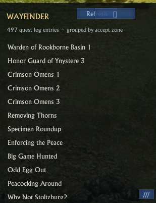

# Wayfinder

**A customizable quest-tracker concept for ArcheRage.**

Wayfinder aims to become a complete, player-configurable replacement for the default quest tracker, while retaining a safe side-by-side mode when replacement is unavailable or unwanted.

---

## Project status: concept / drawing stage

Wayfinder is an early prototype, not an alpha release. The addon has reached the **drawing stage**: it can create and render a tracker frame and sample rows in ArcheRage. The screenshot below records that milestone, but it also captures an earlier broken state. The quest count, zone data, text bounds, button layout, and resizing were not all working in the pictured build. Source changes now address those issues, but they still need a fresh in-game validation pass. There are no releases or user-ready builds.

The present code is a UI prototype restored after crash-isolation testing. A test confirmed that creating a color drawable with the valid `artwork` layer succeeds where the earlier `accent` layer crashed during client startup. This points to an invalid native UI layer argument as the crash cause. It does **not** establish that the complete tracker or its quest behavior works reliably.

**Current confidence:** UI drawing has been observed in-game, and the user confirmed the Addon Manager settings action opens the panel. Quest enumeration still showed 497 entries in the latest supplied screenshot. The corrected journal-status filter and the latest text, layout, and edge-resize code have not yet been verified in-game. Quest tracking, persistence, and replacement behavior remain unverified.

### Drawing-stage screenshot

This is a real in-game screenshot supplied during development, not a finished mockup. It shows that Wayfinder can draw a panel, heading, quest rows, and a refresh control. It also documents the work still in progress at capture time: the list incorrectly showed 497 entries, zone information was unresolved, and the previous resize grip moved the window instead of resizing it. The source has since been updated to filter by journal status, constrain overflowing text, separate the title from its controls, and start resizing from any edge or corner. Those changes are pending a new in-game check; this screenshot does not demonstrate them working.

## What exists in the prototype

- A standalone tracker window intended to run beside the game’s default tracker.
- A launcher button, tracker title, refresh and settings controls, and a preview mode.
- A separate appearance panel with controls for width, font size, row spacing, and opacity.
- A draggable tracker with native edge/corner resizing and saved size/position settings.
- Quest rows grouped by the client quest category, with acceptance-zone fallback when available.
- Fixed-size labels with ellipsis so quest text stays inside the tracker.
- An Addon Manager settings entry that opens Wayfinder’s tracker and settings panel.
- Position locking and saved settings using the addon data API.
- Lua code to enumerate the client quest list, apply the native quest-tracker eligibility filters, show completion state, and request tracking selection.
- Startup diagnostic messages and defensive `pcall` around selected Lua/API operations.

These items describe code currently present, not features confirmed to work in-game. In particular, quest enumeration, quest tracking selection, settings persistence, and the finished visible layout remain unverified.

## Development checklist

### 1. Establish a safe, visible foundation

- [x] Identify and replace the invalid drawable layer value that caused a client crash in isolation testing.
- [x] Restore the full prototype source after the minimal crash-isolation pass.
- [x] Set the prototype to show the tracker at startup for visual testing.
- [ ] Confirm the complete addon reaches the world reliably across repeated launches.
- [x] Load the shared window helper and use its supported settings-panel width.
- [x] Show synthetic preview rows at startup to make the visual smoke test unambiguous.
- [x] Import the `EMPTY_WIDGET` object required by the clipped quest viewport.
- [ ] Verify the viewport initializes and the tracker opens in-game after the import fix.
- [ ] Confirm the panel is visible, positioned correctly, and rendered above the game UI.
- [x] Confirm Addon Manager settings opens Wayfinder; user also confirmed Reset appearance restores the UI.
- [ ] Verify launcher, drag, lock, refresh, settings, and preview controls in-game after the latest source changes.
- [x] Implement edge/corner resizing with bounded extents and saved dimensions.
- [ ] Verify edge/corner resizing, min/max bounds, and saved size in-game.
- [x] Keep tracker labels within their extents with ellipsis; separate title and controls into distinct rows.
- [ ] Verify text clipping and top-control spacing at minimum width and with large font settings.
- [ ] Check UI scaling, resolution changes, saved position, and relog behavior.

### 2. Validate quest behavior

- [ ] Verify active quest list indexing and title retrieval against the live ArcheRage client.
- [x] Filter hidden, today-assignment, saga, public, and zero-status entries; exclude completed main quests.
- [ ] Confirm filtered Wayfinder entries match the player's quest log in-game.
- [x] Group quests by client quest category, falling back to acceptance zone; omit unknown-location headers.
- [ ] Verify category names correspond to useful zone/continent groupings in-game.
- [ ] Determine whether a reliable API maps each quest zone to a continent before adding continent headers.
- [ ] Verify completion state and selected-quest tracking behavior.
- [ ] Match the default tracker’s active quest list without duplicate entries.
- [ ] Add an opt-in option to auto-track recently accepted quests if a sanctioned quest-start event supports it.
- [ ] Investigate a selected-quest arrow and distance indicator using supported map/quest APIs.
- [ ] Handle quest accept, update, complete, abandon, and turn-in events safely.
- [ ] Test empty lists, long titles, large quest counts, and unexpected API results.
- [ ] Confirm that failures are visible and recoverable without destabilizing the client.

### 3. Build the customizable tracker

- [ ] Add configurable colors, typography, row height, padding, background, border, and opacity per element.
- [x] Add a quest viewport that grows to its contents and supports mouse-wheel scrolling; manually resized height is saved.
- [ ] Verify viewport clipping and wheel scrolling in-game.
- [x] Implement bounded edge/corner resizing without a visible resize grip.
- [ ] Verify tracker resizing and persisted dimensions in-game.
- [ ] Add sorting, filters, categories, pinning, and optional completed-quest display.
- [ ] Add collapsible sections and remember each section’s state.
- [ ] Add per-character profiles and settings import/export.
- [ ] Add localization and accessible interaction options.

### 4. Investigate optional integrations

- [ ] Check whether supported events permit automatic refresh without polling.
- [ ] Determine whether any permitted API supports distance, zone, or waypoint data.
- [ ] Research whether the default tracker can be hidden through a documented, permitted method.
- [ ] If replacement is supported, add an explicit opt-in mode with a reliable way to restore the default tracker.
- [ ] Keep side-by-side mode as the default until replacement behavior is verified.

## Intended experience

The long-term goal is a complete visual and functional replacement for the default tracker, with user control over layout, information density, sorting, filtering, interaction, and persistence. Wayfinder should also support running beside the default tracker so players can compare behavior or keep both visible. Replacement mode is conditional on a supported and permitted ArcheRage method; it is not currently implemented or promised.

Potential later additions include focused quest pinning, context actions, completion notifications, optional sounds, map integration, and addon integration hooks. These are exploratory ideas and depend on available APIs and server rules.

## Safety and compatibility

- This addon targets **ArcheRage**. Compatibility with ArcheAge Classic or other servers is not established.
- WoW addons are inspiration for interaction and customization only; WoW APIs do not imply equivalent ArcheRage capabilities.
- Use only sanctioned ArcheRage addon Lua/UI APIs and verify behavior in the target client.
- API reference files can be incomplete or inaccurate. Treat them as clues and confirm important behavior in-game.
- Lua `pcall` can catch ordinary Lua errors; it cannot make unsafe native UI arguments valid or guarantee recovery from a client crash.

## Installation and testing

There is no public release yet. Development testing uses the local addon folder and source tree configured on the maintainer’s machine. Installation instructions will be published once the file layout and in-game behavior are stable.

The test harness opens with a three-row preview. If the tracker is hidden or its launcher is out of reach, open ArcheRage’s Addon Manager and select Wayfinder’s settings button. The user confirmed this entry works; it opens the tracker and settings panel. After **Refresh**, Wayfinder excludes hidden, today-assignment, saga, public, and zero-status entries; it also excludes completed main quests. The X2 API count includes completed history, so the filtered count is the one to compare with the active journal. Distinct quest IDs remain distinct even when titles match. Quest grouping uses the client's quest category name, falling back to acceptance zone when available; unknown locations have no placeholder header. The viewport grows to fit rows unless manually resized, and mouse-wheel scrolling moves through overflow. Drag a tracker edge or corner to resize; dimensions are bounded and saved. Text labels have fixed extents and ellipsis. The latest screenshot still showed 497 entries and the old visible resize grip, so reload the updated source and verify the filtered count, category headers, clipping, top-control spacing, scrolling, edge/corner resizing, and persistence before treating these fixes as confirmed.

## Contributing and feedback

Wayfinder is at the concept stage, so feedback about desired tracker behavior, layout, and useful features is welcome. API proposals should include a reference or reproducible in-game observation, since unsupported UI calls can crash the client.

## License

No license has been selected yet. Until one is added, the repository does not grant permission to redistribute or publish modified copies.
